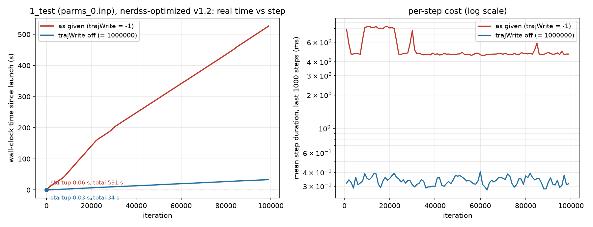

# `1_test` on nerdss-optimized v1.2: timing, profile, and MPI feasibility

Date 2026-10-14. Binary: `nerdss-optimized` at `3505932d` (tag
`nerdss-optimized-ref-2026-10-09`, the v1.2 reference state), built with
`make serial CFLAGS='-O3 -g'` (Apple clang 21, GSL 2.8). Host: Apple M5,
macOS 26. Inputs: `~/Downloads/1_test/parms_0.inp` plus the four `.mol` files
(copied under `inputs/`).

## 1. The model

| | |
| --- | --- |
| Molecules | 895: lipid 278 (`head~U`), adaptor 100, kinase 296, phosphatase 221 |
| Box | 125.4 x 125.4 x 5470.6 nm (membrane 125 x 125 nm, solution 5.5 um tall) |
| Time step, length | 1 us, 100 000 steps (0.1 s), `timeWrite = 1000` |
| Write intervals as given | `trajWrite = -1`, `pdbWrite = -1`, `checkPoint = -1`, `restartWrite = 2000000` |
| rMaxLimit, grid | 55.2 nm, 2 x 2 x 99 sub-volumes |
| Reactions | kinase/phosphatase binding to lipid with `kcat` coupling, adaptor to lipid(P), kinase/phosphatase to membrane-bound adaptor |

No reaction fires in the 0.1 s simulated (copy numbers are constant to the
last row), so every step is pure diffusion plus pair search over monomers.
No 2D survival table is ever built.

## 2. Real time versus step

`time_vs_step.png` / `time_vs_step.csv`; raw timestamped stdout in
`stdout_as_given.ts` and `stdout_trajWrite_off.ts`, `/usr/bin/time -l` in
`time_*.txt`. The timing runs were made one at a time with no profiler
attached; the wrapper `tools/tsrun.py` timestamps each stdout line.

| run | startup (launch to BEGIN SIMULATION) | mean step (ms) | min / max over 1000-step windows (ms) | total wall (s) | user / sys (s) |
| --- | --- | --- | --- | --- | --- |
| as given (`trajWrite = -1`) | 0.06 s | 5.32 | 4.54 / 8.38 | 531.2 | 235 / 291 |
| `trajWrite = 1000000` (off) | 0.03 s | 0.334 | 0.277 / 0.405 | 33.5 | 33.1 / 0.3 |

The overhead is not in start-up (0.06 s) and not in the periodic
`timeWrite` output (invisible in the curve). It is a constant ~5 ms per step,
16x the physics, and it is entirely the trajectory file: the as-given run
wrote `DATA/trajectory.xyz` with 100 001 frames, 10.59 GB. The 8 ms plateau
between steps 8 000 and 22 000 coincides with three processes of another
session running at 98% CPU; the machine is shared, which inflates syscall-bound
time more than compute-bound time.

## 3. Profile

`sample(1)` at 1 ms, 30-second windows, aggregated by `tools/aggsample.py`
(inclusive = share of samples with the function anywhere on the stack; self =
top of stack). Full tables in `profile_as_given_first60s.txt` and
`profile_trajWrite_off.txt`. The profiled runs are separate from the timing
runs because `sample` suspends the process at each sample.

**As given** (first 60 s of the run, 49 346 samples):

| function | inclusive | self |
| --- | --- | --- |
| `write_traj` | 92.4% | |
| `__write_nocancel` (the `write(2)` syscall) | | 61.2% |
| `__dtoa`, `__vfprintf`, `__widen_and_group_float`, `__lo0bits_D2A`, `xsputn` (float formatting) | | ~15% |
| `_platform_memmove` | | 2.0% |
| `__open_nocancel` + `__close_nocancel` (the per-step `ofstream`) | | 1.2% |
| `check_bimolecular_reactions` | 1.6% | 1.1% |
| `Complex::propagate` and its callees | 0.7% | |

**Trajectory off** (whole run, 45 673 samples): the ordinary NERDSS cost
structure for a dilute monomer system.

| function | inclusive | self |
| --- | --- | --- |
| `main` (the inlined step loop: binning, crossing bookkeeping, counters) | 99.8% | 29.6% |
| `check_bimolecular_reactions` | 25.9% | 18.8% |
| `Complex::propagate` | 11.9% | 3.9% |
| `create_complex_propagation_vectors` | 10.5% | 1.5% |
| `reflect_traj_complex_rad_rot` / `_box` | 9.8% | 2.6% |
| `create_euler_rotation_matrix` | 8.5% | 1.1% |
| `gsl_ran_gaussian_ziggurat` + `mt_get` | | 8.2% |
| `__sincos_stret` | | 6.3% |
| `determine_3D_bimolecular_reaction_probability` | 4.8% | 0.9% |
| `Complex::update_properties` | 4.4% | 3.4% |
| `SimulVolume::update_memberMolLists` | 2.2% | 1.6% |
| `check_for_unimolstatechange_reactions` | 2.2% | 1.2% |

0.33 ms per step for 895 molecules is 0.37 us per molecule-step, in line with
the branch's other dilute cases. Nothing in this model is unusually expensive
once the trajectory is off.

## 4. Why this input set is slower than the others

`trajWrite = -1` does not disable trajectory output. In `EXEs/nerdss.cpp` the
frame is written under `if (simItr % params.trajWrite == 0)` with no guard,
and `simItr % -1 == 0` for every `simItr`, so a frame is written every step.
The comment in `parms_0.inp` ("-1 disables") is true of `pdbWrite`, which has
an explicit `!= -1` test, and `checkPoint = -1` is replaced by `nItr / 10`;
`trajWrite` alone has no such handling (same on `master`). None of the
shipped sample inputs uses -1 (their values run from 100 to 500 000 000).

The cost per frame is set by the syscall count, not the bytes:
`src/io/write_traj.cpp` streams `std::flush` after every molecule, so one
frame of this 895-molecule system is ~900 `write(2)` calls plus an
`ofstream` open and close, ~5 ms, against 0.33 ms of physics per step. An
input set with a positive `trajWrite`, or with fewer molecules, does not pay
this, which is why `1_test` looks slow next to its siblings: the simulation
itself is 16x faster than the run as configured, and for a full 100 000-step
run the as-given configuration also leaves a 10.6 GB `trajectory.xyz` behind.

What to change:

1. In the input: `trajWrite = 1000` (one frame per `timeWrite`, 106 MB over
   the run) or any value larger than `nItr` to get the initial frame only.
   `trajWrite = 0` would divide by zero.
2. In the code, on the 1.3 branch: treat `trajWrite <= 0` as off (changes
   behaviour only for inputs that currently write every step), and replace the
   per-molecule `std::flush` in `write_traj` by buffered output with one flush
   per frame. Both leave every simulation output and the file contents
   byte-identical; only the syscall pattern changes.

## 5. MPI from the standalone branch

The standalone MPI code is `upstream-dev/mpi` (`mjohn218/nerdss_development`
branch `mpi`, tip `f1dd0590`, 2025-04-07; `origin/mpi` is a 2024-12 snapshot
671 commits behind it with no shared history). Exported with `git archive`
and built with `make mpi` (Homebrew OpenMPI); it parses this input, including
`kcat` / `coupledRxnLabel` and the lipid state counts.

Its decomposition is along x only: `init_x_domain_and_offset()` (in
`include/split.cpp`) divides the x-bins of the cell grid, each rMaxLimit wide,
across the ranks and adds one ghost bin on each side. This box is 125 nm wide
with rMaxLimit 55.2 nm, so the grid has 2 x-bins: at most two ranks can own
anything, and each rank's ghost zone is the other rank's whole domain. The
membrane area fixes the width, so the box cannot be reoriented without
changing the model.

Measured at 10 000 steps with trajectory output off (`mpi_feasibility.txt`):

| binary | ranks | wall (s) | computation / communication per rank (s) | molecules in merged output |
| --- | --- | --- | --- | --- |
| nerdss-optimized serial | 1 | 4.4 | | 895 |
| standalone MPI | 1 | 17.7 | 16 / 0 | 895 |
| standalone MPI | 2 | 71.6 | 13-20 / 51-58 | 895 (rank 0 owns 0 of them at the end) |
| standalone MPI | 4 | 121.2 | 8-21 / 99-113 | 131 of 895 (wrong) |

Verdict: not feasible for this dataset. Even one rank of the older branch is
4x slower than the optimized serial code, two ranks spend three quarters of
the time communicating, and four ranks lose molecules. The time that matters
here is the trajectory writing, which no decomposition parallelizes; with it
off the whole 0.1 s run takes 34 s in serial.

## 6. Files

| file | content |
| --- | --- |
| `time_vs_step.png`, `.csv` | the plot and its data (both runs) |
| `stdout_as_given.ts`, `stdout_trajWrite_off.ts` | timestamped stdout of the two timing runs |
| `time_as_given.txt`, `time_trajWrite_off.txt` | `/usr/bin/time -l` of the wrapper (instruction counts are the wrapper's) |
| `profile_as_given_first60s.txt`, `profile_trajWrite_off.txt` | aggregated `sample(1)` profiles |
| `mpi_feasibility.txt` | the serial and MPI runs at 1, 2, 4 ranks |
| `inputs/` | the input files as run |
| `tools/` | `tsrun.py`, `profile_run.sh`, `aggsample.py`, `plot_time_vs_step.py` |
