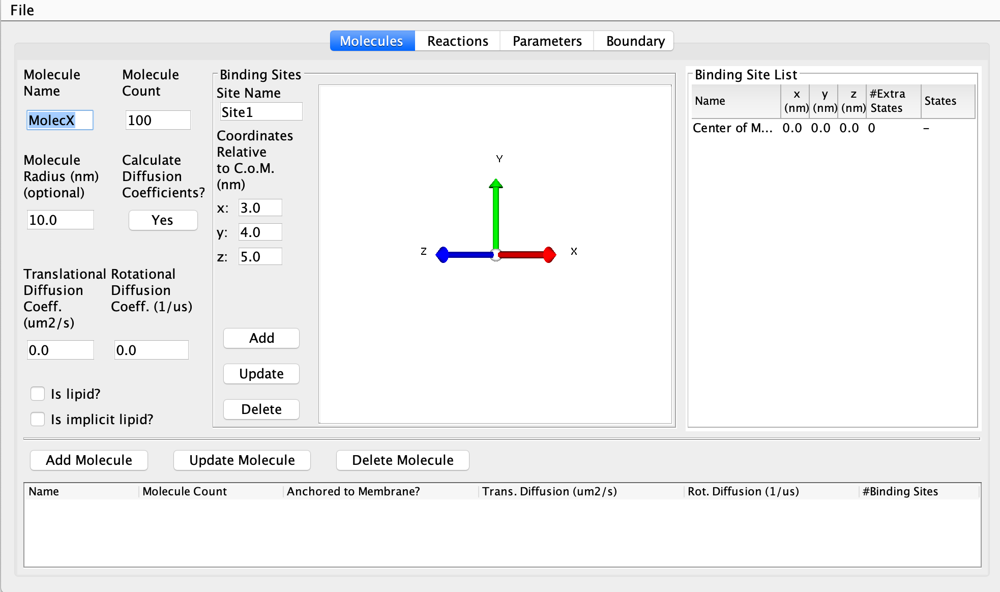
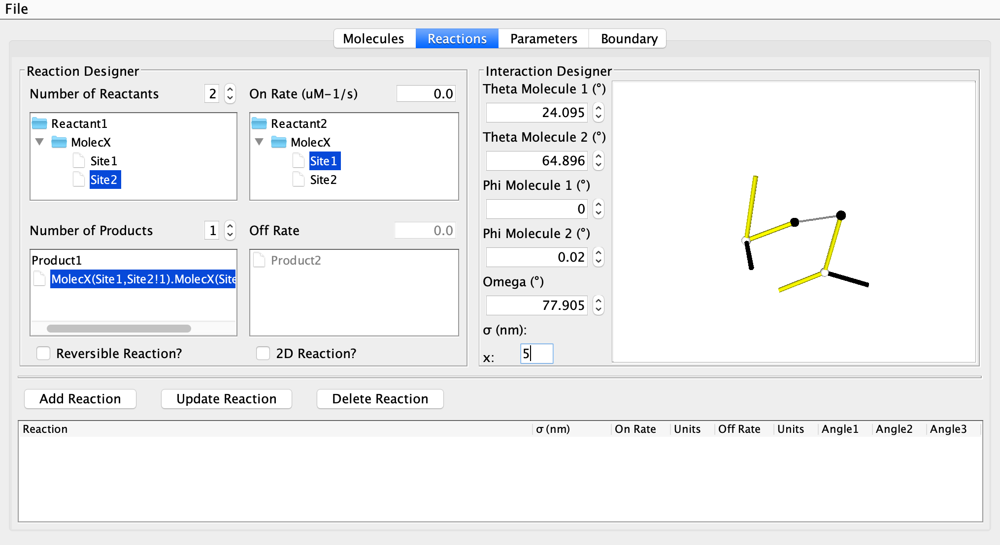
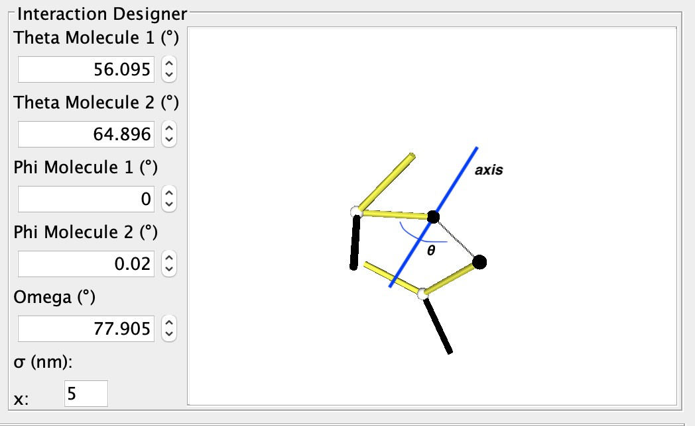
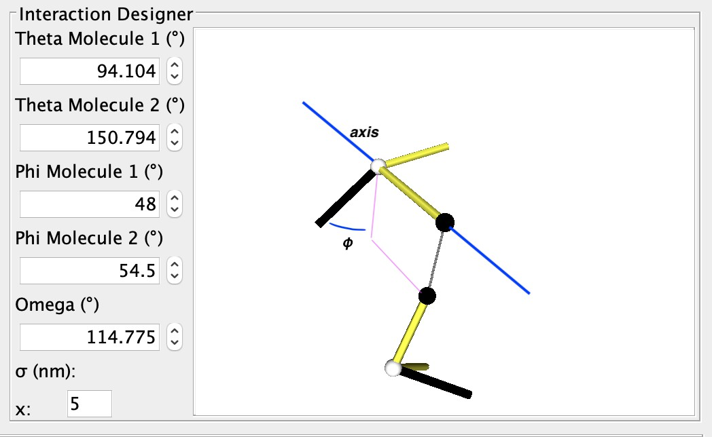
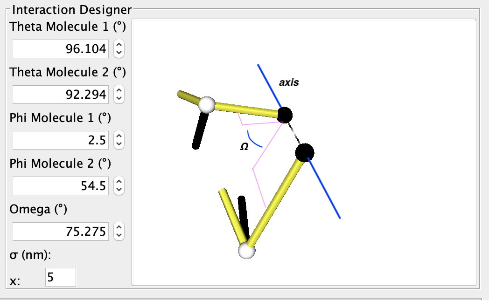

# Non-Equilibrium Reaction Diffusion Self-Assembly Simulator (NERDSS) User Guide

*Updated: May 3, 2025 (date shown in the header of the Word master). Converted to Markdown from `NERDSS_USER_GUIDE_MASTER.docx`, last revised October 28, 2026. This Markdown file is now the editable source; see [README.md](README.md).*

<!-- toc -->
## Contents

- [Dependencies](#dependencies)
- [Building NERDSS](#building-nerdss)
- [Starting a Simulation With NERDSS](#starting-a-simulation-with-nerdss)
- [Running a Restart Simulation](#running-a-restart-simulation)
- [Input and Output files of NERDSS](#input-and-output-files-of-nerdss)
  - [Input Files](#input-files)
  - [Output Files](#output-files)
- [NERDSS parameters](#nerdss-parameters)
  - [Parameters in MOL file](#parameters-in-mol-file)
  - [Parameters in INP file](#parameters-in-inp-file)
- [Use a coordinate file (PDB, XYZ or CSV) to initialize molecules at specific positions.](#use-a-coordinate-file-pdb-xyz-or-csv-to-initialize-molecules-at-specific-positions)
- [NERDSS and Important Rule-based Reaction-Rate considerations](#nerdss-and-important-rule-based-reaction-rate-considerations)
- [NERDSS and time-step selection](#nerdss-and-time-step-selection)
- [Creating Input Files With GUI](#creating-input-files-with-gui)
  - [General](#general)
  - [The Molecule Screen](#the-molecule-screen)
  - [The Reactions Screen](#the-reactions-screen)
  - [The Parameters Screen](#the-parameters-screen)
- [Troubleshooting](#troubleshooting)
  - [Debugging](#debugging)
  - [Build Errors](#build-errors)
- [Citations](#citations)
<!-- tocstop -->

## Dependencies

- C++ compiler, one of the following
  - GCC ≥ 4.9.0
  - Intel ≥ 16.0
  - Clang ≥ 3.3
- GSL ≥ 1.5
- Make ≥ 4.2.1
- Java 8 or higher (for GUI)

## Building NERDSS

Simply run `make serial` within the main directory `NERDSS/` to use build using the provided make file.

The executable will be placed in the `NERDSS/bin` directory.

If you wish to build slightly faster, or are having issues building NERDSS as above, you can try using cmake. To do this:

```sh
mkdir build; cd build
cmake ..
make    # may use -j flag to specify number cores to use
```

The NERDSS Executable will be in the build directory.

## Starting a Simulation With NERDSS

In order to start a new simulation, you need a parameter file with .inp extension, and all .mol file required by that parameter file. mol files specify the structure of specific molecule, including the location of all its interfaces, and both translational and rotational diffusion constants. inp files control reaction rules as well as simulation settings. (see [Input and Output file](#input-and-output-files-of-nerdss) section for more info). All input files can be automatically generated using the provided [GUI](#creating-input-files-with-gui).

If all the input files are correctly formatted, you may run NERDSS with the following command:

```sh
./nerdss -f $YOUR_PARAM_FILE
```

Note that all necessary .mol files (that are referred to by the param file) must be in the same directory as the executable.

Below are some flags that may be helpful:

| Flag | Description |
|------|-------------|
| `-f <filename>`, `--parmfile <filename>` | declares the parameter file (required) |
| `--seed <integer>`, `-s <integer>` | manually declare a seed for RNG (optional) |
| `-c <filename>`, `--coordinate <filename>` | When starting a new simulation, declare a file of initial coordinates (PDB, XYZ or CSV; see “[Use a coordinate file to initialize molecules at specific positions](#use-a-coordinate-file-pdb-xyz-or-csv-to-initialize-molecules-at-specific-positions)”) for placing all or some molecules at given positions (optional). |
| `--debug-force-dissoc` | force dissociation to occur whenever possible (optional, for debug only) |
| `--debug-force-assoc` | force association to occur whenever possible (optional, for debug only) |
| `-r <filename>`, `--restart <filename>` | declares the restart file (optional) |
| `-a <filename>`, `--add <filename>` | During a restart, will read updated and new parameters, added to or overriding from the original parameter file |

## Running a Restart Simulation

During a normal run of NERDSS, a special file called `restart.dat` is written at intervals specified by the user (see [.inp file parameters](#parameters-in-inp-file) section), A restart simulation allows you to start a new simulation from a timestep in a previous simulation at which a restart file was written. .inp and .mol files are not required for a restart simulation.

> [!WARNING]
> **CRITICAL WARNING: Overwriting Output Files**
>
> If you restart a simulation using a command like `./nerdss -r RESTARTS/restart.dat` from the **same directory** where the original simulation was run, NERDSS will **OVERWRITE** existing output files in the `DATA/` subdirectory (e.g., `observables_time.dat`, `copy_numbers_time.dat`, `trajectory.xyz`, etc.).
>
> This happens because these primary data output files are monolithic; they have fixed names and are appended to or overwritten from the beginning when a simulation (or a restarted simulation) starts. In contrast, files in the `PDB/` subdirectory and the restart files themselves in the `RESTARTS/` subdirectory are typically named with timestamps or iteration numbers (e.g., `pdb_1000.pdb`, `restart10000.dat`), so new files are created without overwriting previous distinct ones.
>
> **To avoid accidental data loss, it is STRONGLY RECOMMENDED to run restart simulations in a new, separate directory.** You can copy the required restart file (e.g., `RESTARTS/restart.dat` or a specific `RESTARTS/restart<timeStep>.dat`) and the `rng_state` file from the `RESTARTS/` directory of the original simulation into this new directory. If you are providing an old trajectory file to append to, copy that as well. Then, run the restart command from within this new directory.

**To restart a simulation successfully:**

- Make sure the following are in the same directory as the executable:
  - Restart File (by default `restart.dat`)

  OPTIONAL

  - Trajectory file (optional, a new trajectory file will be created if not providing trajectory file for restart; If restart the simulation from a checkpoint, modify the input trajectory file to make it consistent with the restart timepoint; or restart the simulation without the input trajectory file and concatenate all the trajectory files after the simulation)
  - To restart using the exact same sequence of random numbers, you will also need the `rng_state` file. These are only created if the parameter `debugRNG` is set to ‘true’ in the main executable `nerdss.cpp`. By default, `debugRNG` is ‘false’.

Run restart simulation via: `./nerdss -r $RESTART`, where `$RESTART` is the restart file.

**Restarting and modifying the system:**

When restarting, it can be beneficial to adapt the system by changing the parameters or by adding molecules and/or reactions. This can be done by also reading in a .inp file that is formatted the same way as the `parms.inp` file. This new parameter file can be used to add additional species, change/overwrite the simulation parameters within the parameter block, and to add additional reactions. It Cannot be used to modify the rates in existing reactions—that must be modified (currently) by changing the values stored in the `restart.dat` file.

The command is:

```sh
./nerdss -r $RESTART -a add_parameters.inp
```

Where `$RESTART` is the restart file and `add_parameters.inp` is the parameter file containing new species/reactions

## Input and Output files of NERDSS

### Input Files

#### MOL files

The MOL format (`*.mol`) is used for storing molecule template information being read by NERDSS. The `*.mol` file has the prefix being the molecule with named identically to that used in the reactions, which are defined in the INP format file. The information that can be included in the MOL file are listed [here](#parameters-in-mol-file).

- Required: Molecule name, copy numbers of the molecule, translational diffusion constants, rotational diffusion constants, center of mass coordinates, at least one interface coordinates;
- Optional: whether it is a lipid, whether it is an implicit lipid, interface states, pre-defined bonds.

#### INP files

The INP format (`*.inp`) is used for storing system information being read by NERDSS, and the format is, as much as possible, shared with BioNetGenLanguage (BNGL) for model portability. It can be used for a new simulation. It can also be used for a restart simulation to change the simulation parameters or adding new molecules and reactions to the previous system. The information that can be included in the INP file are listed [here](#parameters-in-inp-file). The information in the `*.inp` file is stored in different blocks. Blocks are started with the ‘start’ keyword and ended with the ‘end’ keyword. Four blocks are used: parameters, boundaries, molecules and reactions. Molecules must be defined before reactions.

- The **parameters block** can include following things.
  - Required: requested number of iterations, timestep length;
  - Optional: interval to write timestep information, interval to write to coordinates file, interval to update the latest restart file, interval to write separate restart files, interval to write individual pdb files.
- The **boundaries block** can include following things.
  - Required: water box dimensions, type of the boundary conditions.
  - Optional: isSphere, radius of sphere.
- The **molecules block** includes the name and starting copy number of the molecules in the system line by line. These should be consistent with the molecule name in the MOL files.
  - One note is that if the system has implicit lipid molecule, you must put it in the first position of the molecules list.
- The **reactions block** includes all the information of the reactions in the system.
  - Each reaction starts with a declaration like this: `A(a) + B(b) <-> A(a!1).B(b!1)`, where A and B are the reacting molecules, a and b are the reacting interfaces. `A(a!1).B(b!1)` is the product, where “!” denotes an interaction with index 1, and “.” Indicates the two molecules are interacting. Reversible reactions are denoted by a double-headed arrow `<->`. Interfaces must be uniquely named, at least on each molecule type. States are allowed and are not required to be binary. Denoted with a tilde. An interface can only change its state or interaction, not both.
  - Ancillary interfaces are allowed. These can include interfaces with/without states/interaction that do not change their state or interaction in the particular reaction but are required for the reaction to occur. For example, a molecule A has two interfaces a1 and a2, with a2 having two states P and U. If an interaction between a1 and some interface b on molecule B is dependent on a2 being in the P state, we can write the reaction as: `A(a1,a2~P) + B(b) <-> A(a1!1,a2~P).B(b!1)`. If an interaction between a1 and some interface b on molecule B is dependent on a2 being bound to something, we can write the reaction as: `A(a1,a2!*) + B(b) <-> A(a1!1,a2!*).B(b!1)`. Here we use wildcard `*` to represent ancillary interactions in the reactants. Another note is that wildcard states are allowed in the reactants/products by omitting the state of an interface which has states. If the state of an ancillary interface does not affect the reaction, it should not be listed. If it is listed, it will be required to be in the state listed.
  - The supported reaction types include reversible binding reactions (`A(a) + A(a) <-> A(a!1).A(a!.1)`), bimolecular association (`A(a) + B(b) -> A(a!1).B(b!.1)`), bimolecular state change (enzyme facilitated state change)(`A(a) + B(a~U) <-> A(a)+B(a~P)`), unimolecular state change (`A(a~S)->A(a~O)`), dissociation (`A(a!1).B(b!.1)->A(a)+B(b)`), creation from concentration (`0 -> A(a)`), creation from molecule (`A(a) -> A(a) + B(b)`), destruction (`A(a) -> 0`).
  - The parameters for a reaction are given below the declaration line by line. Required: 3D microscopic binding rate or macroscopic binding rate, microscopic dissociation rate or macroscopic dissociation rate (only required for reversible reaction). Optional: distance between the two reacting interfaces for a bimolecular reaction (required for bimolecular association), angles for bimolecular association (required for bimolecular association), vector used to calculate the phi1 and phi2 angles (and sometimes omega), label for tracking the reaction product.

### Output Files

**Output Subdirectories:**

- Most standard output data files (DAT, XYZ, PSF) generated during a non-restart simulation are written to a subdirectory named `DATA/`, created within the directory from which nerdss was executed (i.e., where your .inp and .mol files are located).
- All PDB files are written to a subdirectory named `PDB/`. The directory is made only when `pdbWrite` is positive.
- All restart files (checkpointed `restart<nItr>.dat` files and the latest `restart.dat`, along with their corresponding `rng_state` files) are written to a subdirectory named `RESTARTS/`.

#### DAT files

NERDSS produces most of output files in the DAT format. The DAT files whose name ending with `_time.dat` include the quantities of the system as a function of time in a specified aspect. The first line of these `_time.dat` files is the headline and the rest lines are the data recording in a specified interval (the interval parameters are given in the `*.inp` file). The information of different `_time.dat` files are listed here.

- `observables_time.dat`
  - Purpose: Tracks time-dependent quantities of labeled observables specified in the `.inp` file’s reactions section
  - Format:
    - First line is header listing observed labels
    - Subsequent lines are data recorded at intervals defined by the interval parameter in the `.inp` file
- `copy_numbers_time.dat`
  - Purpose: Records time-dependent copy numbers of all species (reactants, products)
  - Format:
    - Header: First column: `Time (s)`, followed by species names (comma-separated)
    - Examples:
      - `C(A1)`: Free A1 interface in molecule C
      - `C(A1!1).A(C1!1)`: A1-C1 bond between molecules C and A
    - Data rows: Time points with corresponding species counts
- `histogram_complexes_time.dat`
  - Purpose: Tracks time-dependent composition and abundance of **complexes**
  - Format:
    - Lines starting with `Time (s): [value]` mark a new time point.
    - Subsequent lines list complexes and their compositions, e.g.,
      `22 C:3. A:2. B:5` means 22 complexes composed of 3 C, 2 A, and 5 B molecules
- `mono_dimer_time.dat`
  - Purpose: Monitors monomers and **perfect dimers** (excludes dimers in larger complexes)
  - Format:
    - Header: `TIME (s)` followed by `MONO:[name]` or `DIMERS W:[name]` (tab-separated).
    - Example: Dimer counts for A (e.g., AB + AC dimers) are summed under `DIMERS W:A`
- `bound_pair_time.dat`
  - Purpose: Tracks all **directly bound pairs** (e.g., A-B bonds) and system-wide loops
  - Format:
    - Header: `TIME(s)`, followed by bound pair names (e.g., `C,A`) and `Nloops`
    - Additional columns track rejected/successful association events
- `transition_matrix_time.dat`
  - Purpose: Logs transitions between cluster sizes (n→m) and tracks lifetimes of molecular sizes
  - Structure:
    - First half: Transition matrix where:
      - Diagonal = counts of unchanged cluster sizes.
      - Off-diagonal = transitions between sizes.
      - Row sums = total n-mers in the simulation.
    - Second half: Lifetime data for each cluster size.
  - Parameters (set in .mol/.inp files):
    - `countTransition`: Enable tracking (default: false).
    - `transitionMatrixSize`: Matrix dimensions (default: 500).
    - `transitionWrite`: Output interval (default: nItr/10).

The `restart.dat` stores all the system information to restart a simulation from the latest step. The `rng_state` file stores the state of the Random Number Generator of the latest step, which is also needed to restart a simulation for a debug task to restart the simulation and capture the previous error. If the corresponding `rng_state` file is used, the trajectory will follow identically. The `restart$timeStep$.dat` and `rng_state$timeStep$` files include the information for restarting a simulation from a specified timestep. And the interval to write these `restart$timeStep$.dat` and `rng_state$timeStep$` files is determined by the checkpoint parameter in the `*.inp` file. The restart simulation is suggested to run in a new directory.

#### XYZ files

The XYZ format is used for coordinate and trajectory written by NERDSS. These files can be visualized by VMD and Ovito. The initial coordinate of all the molecules in the system are stored in the file named `initial_crds.xyz` and the final coordinate of all the molecules are stored in the file named `final_coords.xyz`. The whole trajectory of the system is stored in `trajectory.xyz`. The interval to write coordinates in the trajectory is determined by the parameter `trajWrite` in the `*.inp` file; 0 or a negative value writes no `trajectory.xyz` at all. NOTE: If the total copies of species can change per step, due to creation and destruction, for example, then these will not work in VMD.

#### PSF files

The PSF format is used to specify the rigid molecules in the system, bonds between them, and their copies, for visualization in VMD. There is no way to update these files if the total copies of species can change per step, due to creation and destruction, for example. Then use PDB files with Ovito.

#### PDB files

The optional PDB format output is used for coordinate and trajectory written by NERDSS. Unlike the XYZ file that contains the entire trajectory, this creates an individual file for each frame. The advantage is that these files can be read by Ovito, and do not require the same copy numbers per frame. Thus they are needed to visualize open systems where total copies of species can change.

#### Standard output

NERDSS logs a variety of information of the simulation system to standard output, including the information that is parsed from the input files, the reaction happened in each step, the simulation time information in a fixed timestep interval, and warnings.

## NERDSS parameters

### Parameters in MOL file

`#` is an indicator for comment in the `*.mol` file.

#### `name`

- **Acceptable Values:** String (must provide)
- **Description:** molecule name, must match that used in the `*.inp` file; also consistent with the name of this `*.mol` file
- **Sample:** `name = A`

#### `isLipid`

- **Acceptable Values:** Boolean (optional)
- **Default Value:** false
- **Description:** Is the molecule restricted to the 2D surface? I.e., is it a lipid, or transmembrane protein, etc.
- **Sample:** `isLipid = true`

#### `isImplicitLipid`

- **Acceptable Values:** Boolean (optional)
- **Default Value:** false
- **Description:** Is the molecule an implicit lipid? This is used for simulating binding to a membrane with many lipid binding sites using the implicit lipid model.
- **Sample:** `isImplicitLipid = true`

#### `isPromoter`

- **Acceptable Values:** Boolean (optional)
- **Default Value:** false
- **Description:** Is the molecule restricted to the 1D fiber? I.e., is it a promoter on DNA, or nucleosome bound on DNA, etc.
- **Sample:** `isPromoter = true`

#### `checkOverlap`

- **Acceptable Values:** Boolean (optional)
- **Default Value:** false
- **Description:** is steric overlap checked for during association for this molecule type? Steric overlap checks are applied then to the two molecules binding, and with each of those molecules against the rest of the system.
- **Sample:** `checkOverlap = true`

#### `countTransition`

- **Acceptable Values:** Boolean (optional)
- **Default Value:** false
- **Description:** is size transition counted during simulation for this molecule type?
- **Sample:** `countTransition = true`

#### `transitionMatrixSize`

- **Acceptable Values:** int (optional)
- **Default Value:** 500
- **Description:** size of the transition matrix
- **Sample:** `transitionMatrixSize = 100`

#### `insideCompartment`

- **Acceptable Values:** Boolean (optional)
- **Default Value:** false
- **Description:** this mol type is inside the compartment
- **Sample:** `insideCompartment = true`

#### `outsideCompartment`

- **Acceptable Values:** Boolean (optional)
- **Default Value:** false
- **Description:** this mol type is outside the compartment
- **Sample:** `outsideCompartment = true`

#### `D`

- **Acceptable Values:** Array, [x, y, z] (must provide)
- **Description:** the molecule’s xyz translational diffusion constants
- **Unit:** μm<sup>2</sup>/s
- **Sample:** `D = [25.0, 25.0, 25.0]`

#### `Dr`

- **Acceptable Values:** Array, [x, y, z] (must provide)
- **Description:** the molecule's xyz rotational diffusion constants
- **Unit:** rad<sup>2</sup>/μs
- **Sample:** `Dr = [0.5, 0.5, 0.5]`

#### `COM`

- **Acceptable Values:** coordinates block (must provide)
- **Description:** COM (center-of-mass) denotes the start of the internal coordinates block for the center of mass and all interfaces. interfaceName must be identical to that used in `*.inp` file.
- **Unit:** nm
- **Sample:**

  ```
  COM 0.0 0.0 0.0
  interfaceName1 0.0 0.0 1.5
  interfaceName2 0.0 0.0 -1.5
  ```

#### `bonds`

- **Acceptable Values:** bonds block (optional)
- **Description:** Bonds for the molecule are declared strictly for visualization purposes, not to propagate the system (written to PSF file). A pair of interface names separated by whitespace, the first line is the number of bonds.
- **Sample:**

  ```
  bonds = 2
  com interfaceName1
  com interfaceName2
  ```

#### `state`

- **Acceptable Values:** Single character (optional)
- **Description:** define interface states with the format `$interfaceName~X~Y`, must be consistent with the name used in the `*.inp` file
- **Sample:** `state = interfaceName1~P~U`

#### `mass`

- **Acceptable Values:** Float (optional)
- **Default Value:** Set to the molecule radius. Molecule radius is calculated from the largest distance COM to interfaces.
- **Description:** mass is used only to determine the geometric center of mass of a multi-component complex. Rotation occurs relative to this COM. Mass is effectively unitless, as total mass is divided out.
- **Sample:** `mass = 1`

### Parameters in INP file

`#` is an indicator for comment in the `*.inp` file.

#### parameters block (between `start parameters` and `end parameters`)

##### `nItr`

- **Acceptable Values:** Integer (must provide)
- **Description:** requested number of iterations
- **Sample:** `nItr = 10000`

##### `timeStep`

- **Acceptable Values:** Float (must provide)
- **Description:** timestep length per iteration
- **Unit:** μs
- **Sample:** `timeStep = 0.1`

##### `timeWrite`

- **Acceptable Values:** Integer (optional)
- **Default Value:** 10
- **Description:** iteration interval to print running time information to standard output and to record the copy numbers in the `*_time.dat` files.
- **Sample:** `timeWrite = 100`

##### `trajWrite`

- **Acceptable Values:** Integer (optional)
- **Default Value:** 10
- **Description:** iteration interval to write coordinates to the trajectory file `DATA/trajectory.xyz`; a positive value also writes the first and the last step, and 0 or a negative value writes no trajectory file at all, not even the initial frame
- **Sample:** `trajWrite = 100`

##### `restartWrite`

- **Acceptable Values:** Integer (optional)
- **Default Value:** 10
- **Description:** iteration interval to update “./DATA/restart.dat”. Caution! This is NOT the restart file written in “./RESTARTS/” per interval. To tune that, please use “checkpoint”.
- **Sample:** `restartWrite = 100`

##### `pdbWrite`

- **Acceptable Values:** Integer (optional)
- **Default Value:** -1
- **Description:** iteration interval to write pdb files; -1 means no pdb file output at all, not even of the initial frame (any value of 0 or below is off); a positive value also writes the first and the last step
- **Sample:** `pdbWrite = 100`

##### `bondedComplexWrite`

- **Acceptable Values:** Integer (optional)
- **Default Value:** -1
- **Description:** iteration interval to write bonded complex data to JSON files in “./DATA/COMPEXES/”; -1 means no file output
- **Sample:** `bondedComplexWrite = 100`

##### `checkPoint`

- **Acceptable Values:** Integer (optional)
- **Default Value:** nItr / 10, where nItr is the total number of iterations.
- **Description:** iteration interval to write checkpoint for restart in “./RESTARTS/”.
- **Sample:** `checkPoint = 1000`

##### `transitionWrite`

- **Acceptable Values:** Integer (optional)
- **Default Value:** nItr / 10, where nItr is the total number of iterations.
- **Description:** iteration interval to write transition matrix
- **Sample:** `checkPoint = 1000`

##### `clusterOverlapCheck`

- **Acceptable Values:** Bool (optional)
- **Default Value:** false.
- **Description:** is overlap checked based on cluster
- **Sample:** `clusterOverlapCheck = true`

##### `overlapSepLimit`

- **Acceptable Values:** Float (optional)
- **Default Value:** 0.1
- **Description:** COM-COM distance less than this value is cancelled, for the molecules whose checkOverlap is true.
- **Unit:** nm
- **Sample:** `overlapSepLimit = 3.0`

##### `scaleMaxDisplace`

- **Acceptable Values:** Float (optional)
- **Default Value:** 100.0
- **Description:** association events that result in shifts of an interface on either component by scaleMaxDisplace\* &lt;RMSD&gt; are rejected. Rationale is because these large displacements, due to rotation of large complexes into bound structures, are unphysical. &lt;RMSD&gt; is calculated from `sqrt(6.0*Dtot*dt)` in 3D, and `sqrt(4.0*Dtot*dt)` in 2D.
- **Unit:** nm
- **Sample:** `scaleMaxDisplace = 10.0`

#### boundaries block (between `start boundaries` and `end boundaries`)

##### `WaterBox`

- **Acceptable Values:** Array, [x, y, z] (must provide)
- **Description:** the xyz dimensions of the simulation system
- **Unit:** nm
- **Sample:** `WaterBox = [500.0, 500.0, 500.0]`

##### `xBCtype/yBCtype/zBCtype`

- **Acceptable Values:** reflect (optional)
- **Default:** reflect
- **Description:** the boundary conditions for each dimension
- **Sample:**

  ```
  xBCtype = reflect
  yBCtype = reflect
  zBCtype = reflect
  ```

##### `isSphere`

- **Acceptable Values:** Boolean, True/False (optional)
- **Default:** False
- **Sample:** `isSphere = false`

##### `sphereR`

- **Acceptable Values:** Float (optional)
- **Default:** 0
- **Unit:** nm
- **Sample:** `sphereR=1000`

##### `hasCompartment`

- **Acceptable Values:** Boolean, True/False (optional)
- **Default:** False
- **Sample:** `hasCompartment = true`

##### `compartmentR`

- **Acceptable Values:** Float (optional)
- **Default:** 0
- **Unit:** nm
- **Sample:** `sphereR=1000`

##### `compartmentSiteD`

- **Acceptable Values:** Float (optional)
- **Default:** 0
- **Unit:** nm^2/us
- **Sample:** `compartmentSiteD =10.0`

##### `compartmentSiteRho`

- **Acceptable Values:** Float (optional)
- **Default:** 0
- **Unit:** nm^-2
- **Sample:** `compartmentSiteD =10.0`

#### molecules block (between `start molecules` and `end molecules`)

This block includes all the molecules’ types in the simulation system, and their starting copy numbers. The name of the molecules should be consistent with the corresponding `*.mol` file. One note is that the implicit lipid molecule must be placed firstly if exists.

Sample:

```
ImplicitLipid : Ncopies
moleculeName1 : Ncopies
moleculeName2 : Ncopies
```

If a molecule has more than one state, those can be initialized with distinct copy numbers. In this example, molecule Kinase with site ‘a’ will be initialized with 100 copies in state P, and 200 copies in state U.

Sample:

```
Kinase : 100 (a~P), 200 (a~U)
```

Here is an example for a molecule pip2 that has two sites ‘head’ and ‘tail’, each of which can exist in 2 states, head~U~P and tail~S~D:

Sample

```
pip2 : 60 (head~U, tail~S), 10 (head~P, tail~D), 10 (head~U, tail~D), 10 (head~P, tail~S)
```

#### reactions block (between `start reactions` and `end reactions`)

Each reaction starts with the declaration and followed by the corresponding parameter values for this reaction. The syntax of the declaration and the supported reaction types have been given in the [INP files](#inp-files) Section. Here is the description of the parameters for each reaction.

##### `onRate3Dka`

- **Acceptable Values:** Float (one of onRate3Dka and onRate3DMacro must provide)
- **Description:** 3D microscopic binding rate
- **Unit:** nm<sup>3</sup>/μs (for 2D will be converted to: nm<sup>2</sup>/μs by length3Dto2D; for Creation: M/s)
- **Sample:** `onRate3Dka = 1.0`

##### `onRate3DMacro`

- **Acceptable Values:** Float (one of onRate3Dka and onRate3DMacro must provide)
- **Description:** Macroscopic binding rate, the relationship between 3D microscopic binding rate and macroscopic binding rate for different system can be found in the supporting information of NERDSS paper.
- **Unit:** μM<sup>-1</sup>s<sup>-1</sup> (the relationship between nm<sup>3</sup>/μs and μM<sup>-1</sup>s<sup>-1</sup> is 1 μM<sup>-1</sup>s<sup>-1</sup> = 1/0.602214076 nm<sup>3</sup>/μs)
- **Sample:** `onRate3DMacro = 1.0`

##### `offRatekb`

- **Acceptable Values:** Float (one of offRatekb and offRateMacro must provide for the reversible reaction)
- **Description:** Microscopic dissociation rate
- **Unit:** s<sup>-1</sup>
- **Sample:** `offRatekb = 1.0`

##### `offRateMacro`

- **Acceptable Values:** Float (one of offRatekb and offRateMacro must provide for the reversible reaction)
- **Description:** Macroscopic dissociation rate, the relationship between microscopic dissociation rate and macroscopic dissociation rate for different system can be found in the supporting information of NERDSS paper.
- **Unit:** s<sup>-1</sup>
- **Sample:** `offRateMacro = 1.0`

##### `rate`

- **Acceptable Values:** Float
- **Description:** Use for zeroth order and for first order. If used for bimolecular, will map to onRate3Dka.
- **Unit:** Reaction Order dependent: Zeroth (M/s), First (1/s).
- **Sample:** `rate = 10.0`

##### `sigma`

- **Acceptable Values:** Float (optional)
- **Default Value:** 1.0
- **Description:** distance between the two reacting interfaces for a bimolecular reaction
- **Unit:** nm
- **Sample:** `sigma = 1.0`

##### `norm1/norm2`

- **Acceptable Values:** Vector (optional)
- **Default:** [0, 0, 1]
- **Description:** vectors used to calculate the phi and phi2 angles (and sometimes omega) for a bimolecular reaction, the definition can be found in the supporting information of NERDSS paper. The [angle explorer](../angle-convention.html) shows where each normal enters the phi and omega measurements.
- **Sample:**

  ```
  norm1 = [0, 0, 1]
  norm2 = [0, 0, 1]
  ```

##### `assocAngles`

- **Acceptable Values:** Vector (optional)
- **Default:** [nan, nan, nan, nan, nan]
- **Description:** five angles for bimolecular association, the definition can be found in the supporting information of NERDSS paper. If the angle does not exist, the angle should read “nan”. M_PI is Pi (3.14159). For all ‘nan’, the binding partners are placed at the orientation they are prior to the association event.
- **Unit:** rad
- **Sample:** `assocAngles = [1.5707963, 1.5707963, nan, nan, M_PI]`
- **Interactive tools:** the [angle explorer](../angle-convention.html) shows the bound geometry a set of angles produces, including which angles are undefined and must be `nan`; the [angle solver](../angle-inverse.html) works backwards from bound-state coordinates and `norm1`/`norm2` to the five angles and prints the `assocAngles` line to paste here.

##### `length3Dto2D`

- **Acceptable Values:** Float (optional)
- **Default Value:** 2\*sigma
- **Description:** length scale to convert 3D rate to 2D rate
- **Unit:** nm
- **Sample:** `length3Dto2D = 30`

##### `area3Dto1D`

- **Acceptable Values:** Float (optional)
- **Default Value:** 4\*M_PI\*sigma^2
- **Description:** area scale to convert 3D rate to 1D rate
- **Unit:** nm^2
- **Sample:** `length3Dto2D = 100`

##### `bindRadSameCom`

- **Acceptable Values:** Float (optional)
- **Default Value:** 1.1
- **Description:** scalar multiple of sigma, determines distance between two reactants to force reaction within the same complex
- **Unit:** unitless
- **Sample:** `bindRadSameCom = 1.1`

##### `loopCoopFactor`

- **Acceptable Values:** Float (optional)
- **Default Value:** 1.0 (e.g. exp(-0) )
- **Description:** multiple the rate by this scale factor, used only when closing loops, such as occurs, for example, within a hexagonal lattice. lCF=exp(-∆G<sub>coop</sub>/k<sub>B</sub>T).
- **Unit:** unitless
- **Sample:** `loopCoopFactor = 0.001`

##### `observeLabel`

- **Acceptable Values:** String (optional)
- **Description:** label for tracking the reaction product, the copy numbers of each observeLabel storing in obervables_time.dat
- **Sample:** `observeLabel = leg`

##### `rxnLabel`

- **Acceptable Values:** String (optional)
- **Description:** give the reaction a name. This is helpful if you want to couple a different reaction to this one.
- **Sample:** `rxnLabel = phosphorylateA`

##### `coupledRxnLabel`

- **Acceptable Values:** String from ‘rxnLabel’ (optional)
- **Description:** This allows the completion of a reaction to immediately cause another reaction to happen. The reaction that it triggers must already be a listed reaction, but it will not occur with the rate for that reaction. It will occur with rate ‘kcat’ (see next entry). If kcat is not specified, it will not occur. The reaction it is coupled to must have its own rxnLabel (see previous entry) set, so that this can be mapped to it. Only applies to products of a reaction. Couples currently to dissociation only.
- **Sample:** `coupledRxnLabel = phosphorylateA`

##### `kcat`

- **Acceptable Values:** Float (optional)
- **Description:** For a coupledRxn, will occur with this rate. Therefore, will not be used unless coupledRxnLabel is also specified (see previous entry). Michaelis-Menten reactions, for example, can be defined via a reversible bimolecular reaction, with coupledRxnLabel specified as pointing to a unimolecular reaction that changes state, and kcat specified.
- **Units:** s-1.
- **Sample:** `kcat = 1.0 #s-1`. For example see `sample_inputs/VALIDATE_SUITE/michaelis_menten/`

##### `excludeVolumeBound`

- **Acceptable Values:** Bool (optional)
- **Default:** False
- **Description:** Once two sites are in the bound site (where being bound, they cannot undergo additional bimolecular reactions), by default they will not try to bind and therefore will not exclude volume with any other sites.
- **Sample:** `excludeVolumeBound = false`

## Use a coordinate file (PDB, XYZ or CSV) to initialize molecules at specific positions.

Use the option `-c (--coordinate) <coordinate file>` to initialize all or part of molecules at specific positions. The coordinates of each molecule’s center of mass (COM) given in `<coordinate file>` will be the initial coordinates of that molecule ‘s COM. The interfaces will be initialized at positions given by `*.mol` files (only a translation is applied; orientations stay random). For each molecule name the first N molecules of that type, in the order of the molecules block, are moved onto the first N rows for that name; rows beyond the copy number are ignored, a name that is no molecule in the system is skipped, and molecules the file does not place keep their random positions (a random molecule that overlaps a placed one is moved afterwards). Coordinates are in nm, in the internal frame where the box runs from -L/2 to +L/2 on every axis (0 is the box center); `DATA/initial_crds.xyz` and the trajectory use that frame, while the PDB output is shifted by +L/2 and must be shifted back before it is given to `-c`. Three formats are read. The format is taken from the file extension (`.pdb`, `.xyz` or `.csv`, case does not matter); with any other or no extension it is taken from the content: a line starting with `ATOM` or `HETATM` means PDB, a first non-blank line that is a single whole number means XYZ, a first non-blank line holding a comma means CSV, and anything else stops the run. The log reports the choice (“`coordinate file format: XYZ (from extension)`”).

**PDB.** A PDB `<coordinate file>` should follow these rules:

- Column 1~6 is the record name, usually it is literally “ATOM ”
- **Column 13-16 is the atom name.**
- **Column 18-20 is the molecule name. (This is usually the residue name in common PDB files)**
- Column 31-38: X coordinate.
- Column 39-46: Y coordinate.
- Column 47-54: Z coordinate.
- **All molecules must have an atom named COM to be used for moving the center of mass to specified coordinates. Other atoms and molecules without COM will be ignored.**
- **The number of molecules of each molecule type must be no more than the copy number specified in the INP file. To be clear, all molecules have COM must be specified by the INP file.**

The bolded rules are different from common PDB files.

**XYZ.** An XYZ `<coordinate file>` should follow these rules:

- Line 1 is the number of rows. Line 2 is a comment line and is always skipped, even when it is empty.
- Every following line is one molecule: `<name> <X> <Y> <Z>`, separated by spaces or tabs, exactly four fields. Blank lines are skipped.
- If the file holds fewer rows than line 1 announces, the run stops with an error; if it holds more, a warning is printed and the extra rows are ignored.
- NERDSS’s own `DATA/initial_crds.xyz` looks like an XYZ file but lists each interface under the molecule name after the COM line, so fed back as-is every interface would be taken for another molecule. Keep only the COM lines (and correct line 1) before using it as an input.

**CSV.** A CSV `<coordinate file>` should follow these rules:

- One molecule per line: `<name>,<X>,<Y>,<Z>`, exactly four fields. Spaces around the fields, Windows (CRLF) line endings and blank lines are tolerated.
- A header row is optional. The first non-blank row is taken as a header when its 2nd or 3rd field is not entirely a number (“x”, “1st” or “5.5x” are not numbers; “5.5” is), and is then skipped.

In XYZ and CSV files the name is matched exactly against the Name in the .mol file and has no length limit (PDB names are limited to 4 characters by the format). A malformed XYZ or CSV row — not four fields, or a coordinate that is not a number — stops the run with the file name and the line number. The PDB reader does not validate its input.

## NERDSS and Important Rule-based Reaction-Rate considerations

- An important property must be noted when a molecule has multiple interfaces, A(a,b), and can bind itself, with a distinct interface: e.g. `A(a)+A(b) <->A(a!1).A(b!1)`. These reactions will read in k<sub>a</sub><sup>3D</sup> values, such that K<sub>D</sub>=k<sub>b</sub>/k<sub>a</sub><sup>3D</sup>, with no automatic re-scaling. This is fine for a molecule like Actin, that binds to itself using two distinct interfaces (`A(barbed end)+A(pointed end)->`). However, for models such as clathrin, the distinction between an ‘a’ site and a ‘b’ site is purely a label to distinguish their coordinates in space. In reality, they are all structurally/chemically identical sites, and all interactions are possible (`A(a)+A(a)->`, `A(a)+A(b)->`, `A(b)+A(b)->`). To correct for this distinction arising purely due to labeling, for these specific cases, **users should input rates multiplied by two**, relative to the case where both labels are the same. For example:

  - `A(a)+A(a) <-> A(a!1).A(a!1)` onRate3Dka=1
  - `A(a)+A(b)<-> A(a!1).A(b!1)` onRate3Dka=2

  The rate for the true self interaction (i.e. onRate3Dka=1 in the example above), is the one that corresponds to the K<sub>D</sub> given all identical sites. If this change is not done by the user, and the same rates are used for the A(a)+A(a) binding for clathrin sites, as for the A(a)+A(b) binding for clathrin sites, the equilibrium will not match what is thermodynamically expected. This is also discussed as well in [Ref. 2](#citations), and applies to all rule-based, rate-based reactions (noted in NFSim—here they automatically divide self- rates by 2). What we want is that 2\*A(a!).A(a!)=A(a!).A(b!) = A(a!).A(c!). Same for sites b and c. Then, each product/complex type has the same number of ‘a’ sites bound, due to having the same binding free energy. This result emerges due to the combinatorics of choosing two of the same molecules from A<sub>tot</sub>=N<sub>0</sub>, vs one molecule A from A<sub>tot</sub>=N<sub>0</sub> and one molecule B from B<sub>tot</sub>=N<sub>0</sub>. They produce an identical equilibrium with the same number of A in bound states when A<sub>eq</sub><sup>self</sup>(K<sub>D</sub>)=A<sub>eq</sub><sup>distinct</sup>(K<sub>D</sub>/2)=B<sub>eq</sub><sup>distinct</sup>(K<sub>D</sub>/2).

- As described in the NERDSS paper, the reaction rates are input by the user as the 3D values, k<sub>a</sub><sup>3D</sup>, and the code will convert them to values needed for the appropriate reaction kinetics. We always have that K<sub>D</sub>= k<sub>b</sub>/k<sub>a</sub><sup>3D</sup>= k<sub>off</sub>/k<sub>on</sub><sup>3D</sup>, based on the user-input rates. For information on what rates are needed to give to the Green’s function to recover appropriate reaction kinetics, see [Ref 2](#citations), SI.

## NERDSS and time-step selection

- To maintain at most two-body interactions between all reactant pairs per time-step (approximately), the time-step is limited (usually) by the bimolecular reactions and the density of those reactants, and their diffusion coefficients. Based on the definition of R<sub>max</sub> for the FPR algorithm [[3]](#citations), or the maximum distance a particle could diffuse in a step and collide with a partner, a minimum time-step for a given reactant B due to binding to A in 3D is:

  $$\Delta t^{3D} = \frac{1}{56(D_{A} + D_{B})}\left[ \left( \frac{3}{4\pi\rho_{A}} + \sigma^{3} \right)^{1/3} - \sigma \right]^{2}$$

  where $\rho_{A} = \frac{N_{A}}{V}$. A minimum time-step for a given reactant B due to binding to A in 2D is:

  $$\Delta t^{2D} = \frac{1}{36(D_{A} + D_{B})}\left[ \left( \frac{1}{\pi\rho_{A}} + \sigma^{2} \right)^{1/2} - \sigma \right]^{2}$$

  where $\rho_{A} = \frac{N_{A}}{Area}$, and the diffusion coefficients are the (slower) values in 2D, on the surface. These can be approximated as comparable to the lipid diffusion coefficients (~0.5 μm<sup>2</sup>/s). The dependence on σ is weak as it nearly cancels for most systems. The time-step for the system is the minimum of all the time-steps, we typically set default values of 0.1-1 μs.

- The time-step can also be limited by the speed of unimolecular reactions. This is mitigated by the fact that now, unimolecular reactions in NERDSS are determined on a population level, and thus instead of evaluating the probability for each specie individually, the number of events is calculated from a Poisson distribution, based on N total species. However, for a model where only one molecule, for example, can form a complex and dissociate, if k\*dt is relatively large, say &gt;0.001, then error can occur due to the fact that over the course of dt, more than one event should occur, but only one is allowed. Hence a smaller time-step is necessary.

- NERDSS will still propagate dynamics effectively with steps larger than the minimum suggested above. Particularly if systems spend minimal time in their densest state, the error due to choosing a larger step will be small, and empirically, the error for many-body systems is relatively small even when the two-body requirement is not closely maintained. Nonetheless, a smaller time-step will ensure more accurate propagation of dynamics.

## Creating Input Files With GUI

### General

This is a Graphical Interface for creating input files for NERDSS. It allows you to define all the molecules, reactions, boundary conditions, and other parameters for your simulation.

### The Molecule Screen



Above is the opening screen for the GUI. Here you can add all the individual molecules that will be included in your simulation. You must also specify each binding site as a vector from its molecule’s center of mass. Binding will occur at the terminal end of this interface vector. Each binding site must be added a molecule, and the molecule must be added to the molecule list, in order for it to appear on the reactions screen.

### The Reactions Screen

This is where you can specify all possible reactions. You can do both unimolecular and bi molecular reaction. Since there are no association angles for a unimolecular reaction, the 3D pane on the right will only appear once a bimolecular reaction is specified.



**Sigma:** Sigma is the association distance (in nm) for a reaction between two interfaces. It is represented as the dotted line between the two interface vectors. Only its length may be changed - positions of both other molecules are defined relative to it.

**The Normal Vector:** The solid black line is the normal vector. It does not have any physical significance, but is instead used as a reference point for the phi angle, which measure the rotation of the molecule about a given interface vector.

**The Angles:**

Five angles are used to specify the geometry of association. To see each one on a live 3D model, measured exactly as the simulator measures it, use the [angle explorer](../angle-convention.html); to get the angles from coordinates you already have, use the [angle solver](../angle-inverse.html).

- **Theta (one for each molecule)** *[0 < Θ < π]*

  Theta is the angle between the interface vector and sigma. It’s axis of rotation is the cross product of the sigma vector and a given interface vector.

  

- **Phi (one for each molecule)** *[-π < Φ < π] \**

  *\*note that this range is converted to [0 < Φ < 2π] when angles are output to .parms file.*

  Phi is the dihedral angle between the normal vector and the sigma vector. It can be thought of as defining the rotation of a molecule about its interface vector.

  

- **Omega** *[-π < Ω < π]\**

  *\* note that this range is converted to [0 < Φ < 2π] when angles are output to .parms file.*

  Omega is the dihedral between the two interface vectors, with sigma has the axis of rotation.

  

  *\*\*There may be some small unexpected graphical behavior when changing omega. The display is corrected quickly and this will not affect simulations.*

Note that the angle spinners may not be able exactly reach boundary conditions (e.g. theta may not get all the way to 180 degrees or all the way down to -180 degrees). When simulation input files are created, these angles will be set equal to the boundaries. The GUI will output angles at a precision of 1 degree. Also note that the angles are displayed in degrees on the spinners for easy interpretability, but are always stored internally and written to the .parm file in radians.

**On Rate: onRate3Dka** This is required for all reactions. Specifies the association rate constant.

**Off Rate: offRatekb** Only needed for reversible reactions. Specifies the disassociation rate constant. Do not specify that that a reaction is reversible and then leave the Off Rate at 0. This may cause errors.

**2D Reaction:** Weather the reaction is limited to species on a 2D surface (e.g. a membrane).

**Managing Reactions:** Use the Add reaction button to add the current reaction to the simulation. To update a reaction, first select a reaction from the list, then change its parameters, and finally click Update Reaction. To remove a reaction from the simulation, first select a reaction from the list, then click Delete Reaction.

### The Parameters Screen

**Time Step:** The length of time in μs between each iteration of the simulation.

**Number of Time Steps:** The length of the simulation in iterations.

**Freq to Print Configuration:** How many iterations are between each print of the current configuration.

**Freq to Print Statistics:** How many iterations are between each print of the current statistics.

**Freq to Print Restart File:** How often to print a restart file (in iterations) – the restart file can be used to start a new simulation at a later date from this point in the current simulation

#### The Boundary Screen

As of right now, the GUI can only output simulation with a box boundary condition. The output parameter files may be edited manually for spherical boundaries.

Simply specify the box dimensions along the x, y, and z axis.

**Create parameter file:**

To output .mol and .parm files to run simulations with, click Create Parameter Input Files. Then select the directory to place them in. To run simulations, place these files in the same directory as the Nerdss executable.

## Troubleshooting

### Debugging

Can do general debugging by building NERDSS using:

```sh
cmake -DCMAKE_BUILD_TYPE=Debug
```

Instead of just normal cmake.

- `-g`: generate debugging tables for GDB/LLDB
- `-fsanitize=address`: Uses a sanitizer to give information about memory access issues, such as out-of-range element access
- `-fno-omit-frame-pointer`: stores the stack frame pointers for functions (needed for `-fsanitize`)

### Build Errors

Build issues may occur on system configurations that NERDSS was not tested on, particularly on super computers and large clusters. A common issue is cmake having issues finding GSL when it is installed in a non-standard location. This is easily solved by setting the `GSL_ROOT_DIR` environment variable using:

```sh
export GSL_ROOT_DIR="correct_path"
```

If make cannot find a recipe for ‘all’, (`Makefile:83: recipe for target 'all' failed`), specify the target for NERDSS, e.g. `make nerdss`

## Citations

1. Varga, M.<sup>◇</sup>, Y. Fu<sup>◇</sup>, S. Loggia, O.N. Yogurtcu, and M.E. Johnson. NERDSS: a non-equilibrium simulator for multibody self-assembly at the cellular scale. *In Revision.*
2. Johnson, M. E. Modeling the Self-Assembly of Protein Complexes through a Rigid-Body Rotational Reaction–Diffusion Algorithm. J. of Phys. Chem. B 2018, 122, 11771–11783.
3. Johnson, M.E., and G. Hummer. Free propagator reweighting integrator for single-particle dynamics in reaction-diffusion models of heterogeneous protein-protein interactions systems. Phys. Rev. X 4, 031037 (2014)
4. Yogurtcu, O.N., and M.E. Johnson. Theory of bi-molecular association dynamics in 2D for accurate model and experimental parameterization of binding rates. J. Chem. Phys. 143, 084117 (2015)
5. Yogurtcu, O.N., and M.E. Johnson. Cytoplasmic proteins can exploit membrane localization to trigger functional assembly. PLoS Comput. Biology 14, e1006031 (2018)
